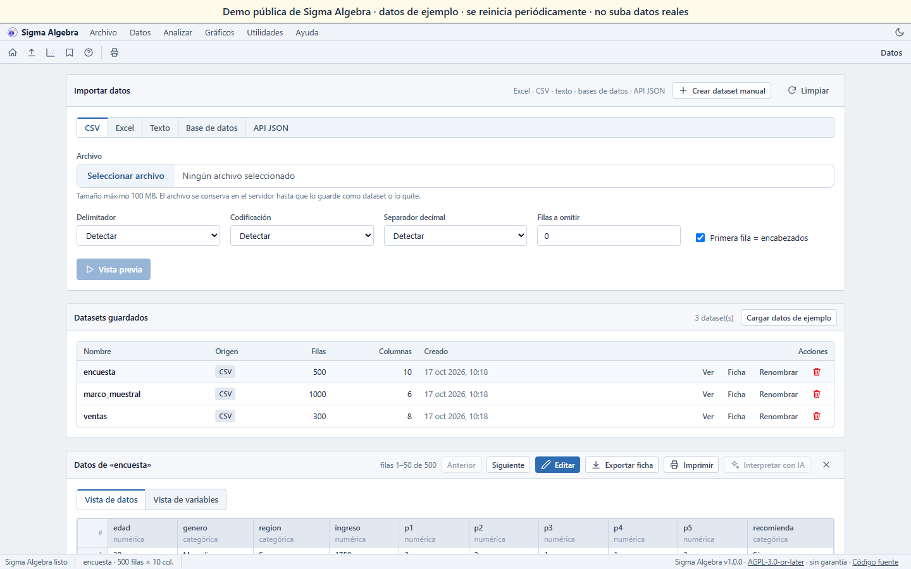
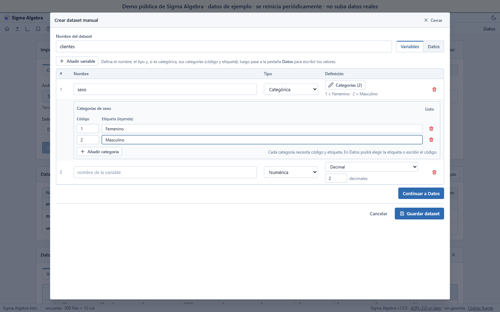
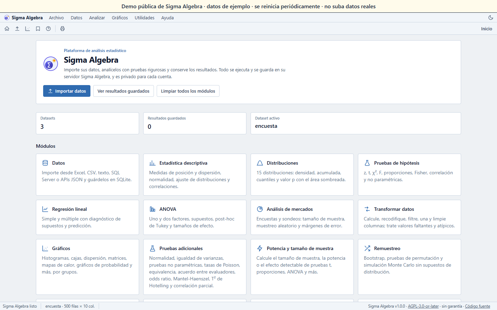

<p align="center"></p>

# Sigma Algebra Analisys Statistics Software (SAAS)

[](LICENSE)
[](https://github.com/saffron777/sigma-algebra-analisys-statistics-software-saas/actions/workflows/ci.yml)
[](Dockerfile)
[](pyproject.toml)

**A self-hosted statistics and reporting web app.** Import CSV, Excel, text, databases or JSON APIs;
run descriptive statistics, hypothesis tests, regression/ANOVA, survey sampling, SPC/DOE and more;
explore charts and export PDF/Word/Excel reports. Multi-user, private per account, and installable
with Docker in minutes.

[Español](README.es.md) · [Website](site/index.html) · [Deployment](docs/DEPLOYMENT.md) · [Releasing](docs/RELEASING.md) · [Demo setup](docs/DEMO.md)

> **"SAAS" is part of the product name.** Sigma Algebra is self-hosted free software, not a hosted
> service. The code is licensed under **AGPL-3.0-or-later**; if you run a modified version as a
> network service, you must offer its corresponding source to users.


## Screenshots

| Data and import | Categorical variables | Overview |
|---|---|---|
|  |  |  |

## Why Sigma Algebra?

- **No desktop installs.** Students and analysts open a browser; the server does the work.
- **Your data stays on your server.** There is no telemetry and no update check. The only optional
  outbound feature is AI interpretation, enabled per account and per click.
- **Multi-user by design.** Each account sees only its own datasets, saved results and notebooks;
  administrators manage accounts and the database.
- **A statistics workbench, not a spreadsheet.** Tests, models, charts, reports, surveys and quality
  tools share one data model and one result history.
- **Free software.** AGPL-3.0-or-later, with no per-seat license and no proprietary lock-in.

## Quick start with Docker

The published image (once the first release is out):

```bash
docker run -d --name sigma \
  -p 127.0.0.1:5000:5000 \
  -v sigma_data:/app/instance \
  -e SIGMA_SECURE_COOKIES=0 \
  ghcr.io/saffron777/sigma-algebra-analisys-statistics-software-saas:latest
```

Or build and run from this checkout:

```bash
docker compose up --build -d
```

Open <http://127.0.0.1:5000>. The first visit asks you to create the administrator account. Data is
stored in the `sigma_instance` volume (SQLite by default; SQL Server, MySQL/MariaDB, PostgreSQL,
Oracle and MongoDB are also supported). For production, put Sigma behind an HTTPS reverse proxy and
read [docs/DEPLOYMENT.md](docs/DEPLOYMENT.md). To publish the container image, see
[docs/PUBLISH_DOCKER.md](docs/PUBLISH_DOCKER.md).

## Local development

Requirements: Python 3.11+, Node.js 20+, and the system libraries listed in
[docs/DEPLOYMENT.md](docs/DEPLOYMENT.md).

```bash
python -m venv .venv
# Windows:
.\.venv\Scripts\python.exe -m pip install -r requirements-dev.lock
# Linux/macOS:
./.venv/bin/python -m pip install -r requirements-dev.lock
npm ci
npm run build
python scripts/make_sample_data.py
```

Run it:

```bash
# Windows
.\.venv\Scripts\python.exe run.py
# Linux/macOS
./.venv/bin/python run.py
```

The app listens on <http://127.0.0.1:5000>. Use `SIGMA_DEBUG=1` for auto-reload during development.
`requirements.lock` is the runtime-only lock used by the Docker image;
`requirements-dev.lock` adds tests and linting.

## What it does

| Area | Highlights |
|---|---|
| **Data** | Import **CSV, Excel, text, SQL Server, MySQL/MariaDB, PostgreSQL, Oracle, MongoDB and JSON APIs**; preview, edit column types, define categorical variables with **code + label**; save to the configured database. |
| **Descriptive statistics** | Location, dispersion, shape, confidence intervals, frequencies, normality tests, distribution fitting (KS/AIC), correlations with p-values. |
| **Distributions** | 15 distributions: density/mass, CDF, quantiles, probability between two values and a shaded p-value. |
| **Hypothesis tests** | 16 tests: z, t (one sample, two samples, paired), proportions, exact binomial, χ², F, Fisher, correlation, Mann-Whitney, Wilcoxon, Shapiro; from columns or summary statistics. |
| **Regression and models** | Simple/multiple linear regression (with categorical predictors), ANOVA, assumptions, influence diagnostics, prediction intervals; count, logistic, multinomial, ordinal and survival models; SEM. |
| **ANOVA and DOE** | One/two-factor ANOVA, Welch, interactions, Tukey HSD, effect sizes; factorial designs, response surface, optimization, power. |
| **Surveys and markets** | Sample size, probabilistic sampling (simple, systematic, stratified, clusters), margins of error, cross-tabulation, Likert scales. |
| **Quality** | Control charts, process capability, Gage R&R, acceptance sampling and SPC. |
| **Data preparation** | Formulas, recoding, binning, dummies, standardization, transformations, lags/differences, filters, duplicates, train/test splits, joins/appends, missing values (KNN/MICE), outliers. |
| **Charts** | Histograms, box/violin, Q-Q, scatter/bubble, matrices, correlation heatmaps, contours, 3D, lines, bars, Pareto, pie and confidence intervals. |
| **Reports** | Save results, add notes, export PDF, Word and Excel; print-ready views. |
| **Notebooks** | Optional Python/R console and Jupyter notebooks for each account, with `sigma.load`/`sigma.save` helpers. |
| **AI (optional)** | Per-user, per-click interpretation of a result; disabled when no provider is configured. |

## Security and privacy

- Local accounts with per-user data isolation; admins manage users and database settings.
- Session cookies with CSRF tokens and `SameSite`; enable `SIGMA_SECURE_COOKIES=1` behind HTTPS.
- No telemetry, analytics or update checks. See [PRIVACY.md](PRIVACY.md).
- Report vulnerabilities privately as described in [SECURITY.md](SECURITY.md).

## Limitations

- The UI and most documentation are in Spanish; the English README and landing page are the entry
  point for international users.
- No 2FA/SSO, email password recovery or per-object sharing yet.
- Not a drop-in SPSS/Minitab replacement: syntax files, some repeated-measures designs and some
  specialized procedures are not implemented. See [docs/EQUIVALENCIAS.md](docs/EQUIVALENCIAS.md) for
  the supported equivalents.
- The optional AI feature sends the selected result summary to the provider you configure.

## License, source and credits

Copyright (C) 2026 Frank Miranda. Licensed under
[GNU AGPL-3.0-or-later](LICENSE). See [NOTICE](NOTICE), [third-party notices](THIRD-PARTY-NOTICES.md),
[trademarks](TRADEMARKS.md) and the license texts in [LICENSES/](LICENSES/).

Source code: <https://github.com/saffron777/sigma-algebra-analisys-statistics-software-saas>

Third-party components include Flask, pandas, NumPy, SciPy, statsmodels, scikit-learn, Plotly,
JSpreadsheet, Alpine.js, KaTeX, DOMPurify and DejaVu fonts; their licenses are in `LICENSES/`.

## Contributing

Contributions are welcome. Read [CONTRIBUTING.md](CONTRIBUTING.md) and
[CODE_OF_CONDUCT.md](CODE_OF_CONDUCT.md), run `ruff check .` and `pytest`, and sign off your commits
(`git commit -s`). For release steps see [docs/RELEASING.md](docs/RELEASING.md).
